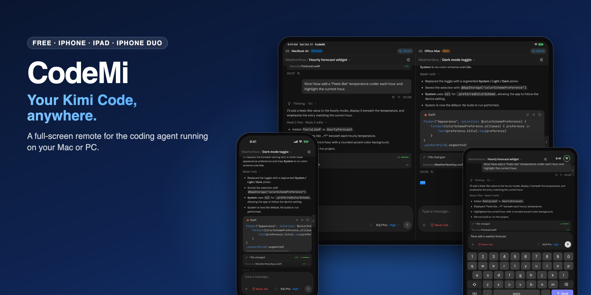
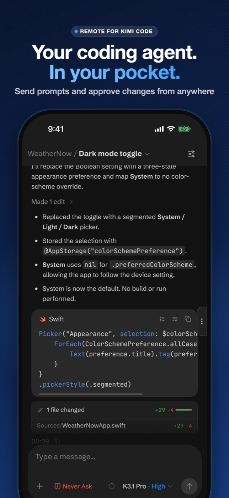
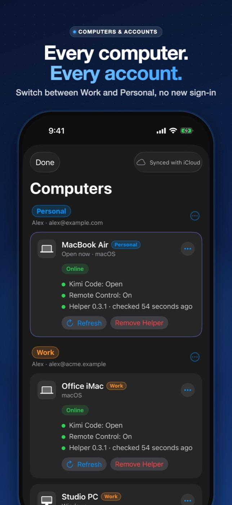
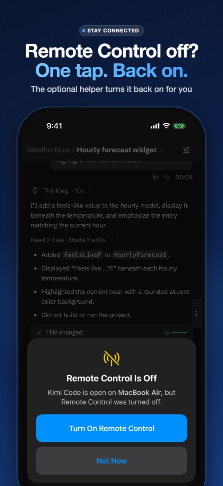
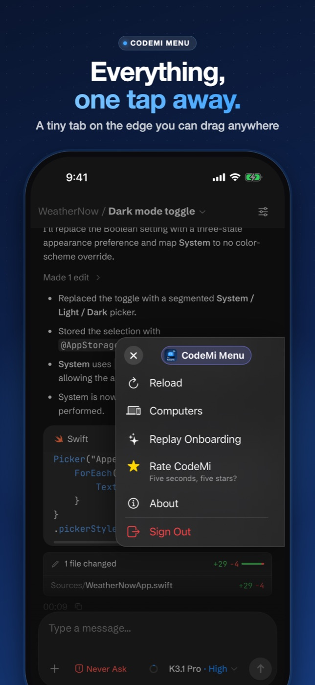
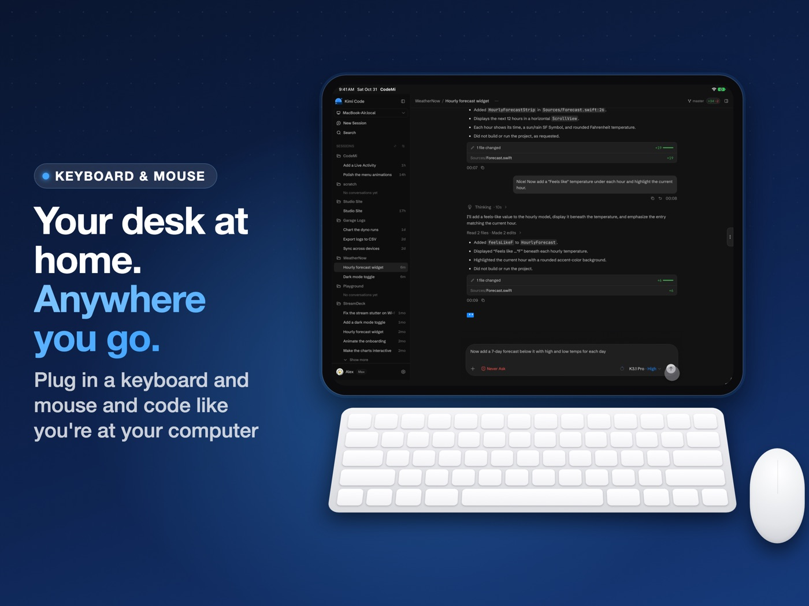
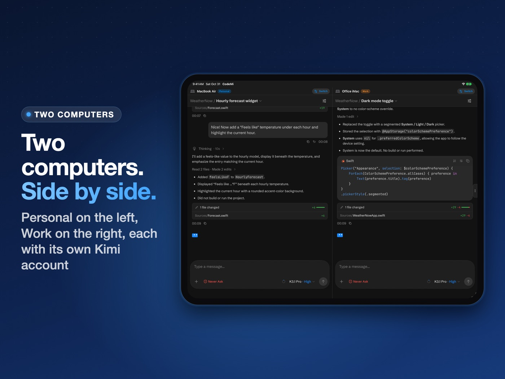
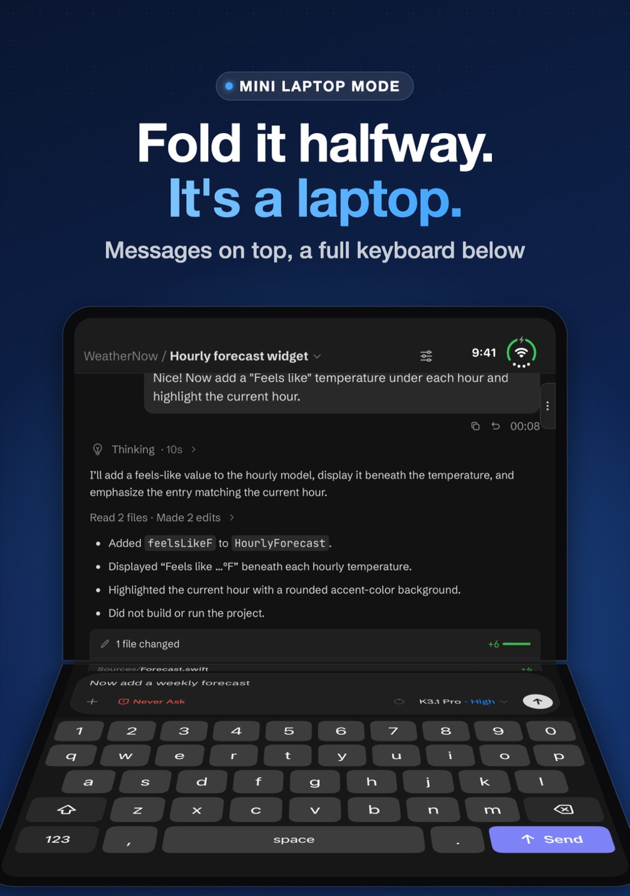
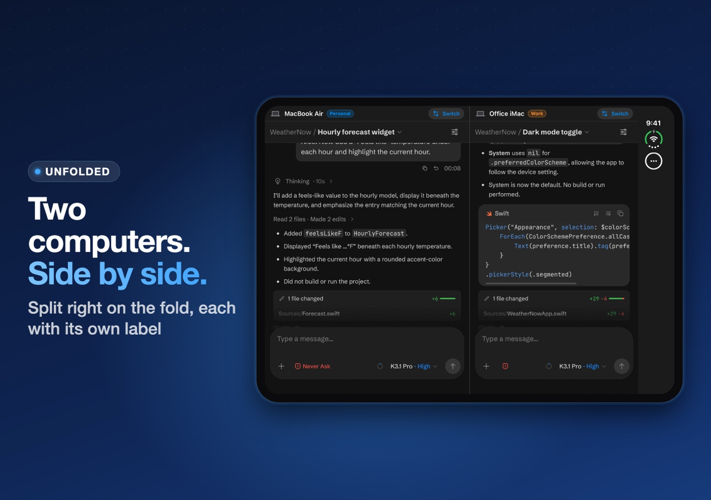

  

<h1 align="center">CodeMi: Kimi Code Remote</h1>

  <b>Your Kimi Code, anywhere.</b> A free, full-screen remote for the Kimi Code agent running on your Mac or PC. 
  iPhone · iPad · iPhone Duo

  
  &nbsp;&nbsp;
  

  <a href="#why-i-built-it">Why I built it</a> ·
  <a href="#what-it-does">What it does</a> ·
  <a href="#the-codemi-helper">The helper</a> ·
  <a href="#privacy">Privacy</a> ·
  <a href="https://github.com/mannyd209/codemi/issues/new/choose">Report a bug / request a feature</a>

---

## Why I built it

Hi, I'm Manny from **MannyD Labs**. I've been writing code for more than ten years, mostly iOS, and lately Android, Mac and Windows apps, plus custom software for companies.

I built CodeMi because I got sick and tired of losing my connection. A coding app would update or switch Remote Control off, and suddenly my phone couldn't reach my computer anymore. I travel a lot, so my MacBook isn't always with me, and for quick things I'd much rather just pull out my phone.

And honestly, one of the biggest reasons: we have a family trip to Disneyland coming up, and I'd like to get a little coding done while we wait in line. 😄

So CodeMi does two things really well: it gives you a clean, full-screen Kimi Code wherever you are, and when Remote Control gets switched off, it turns it back on with one tap.

## What it does

Kimi Code does the real work on your own computer: it runs the agent, reads your project and runs commands. CodeMi is a clean, full-screen remote for it. Check on a long task from the couch, send the next prompt from the grocery line, or approve a change without walking back to your desk.

### iPhone
Full-screen and edge to edge, with a tiny tab on the side for everything CodeMi does.

  
  
  
  

### iPad: your desk at home, anywhere
Plug in a keyboard and mouse and it feels like coding at your computer at home. The on-screen keyboard stays out of the way while a hardware keyboard is connected, and a mouse or trackpad clicks, selects and hovers like on a Mac.

- **Desktop:** Kimi Code's full layout, with your sessions, chat and code.
- **Two Computers:** two computers side by side in landscape, each with its own Kimi account and label.
- **Portrait:** one computer, full screen.

  
  

### iPhone Duo: fold it into a mini laptop
- **Half-folded:** messages on the top screen, a full keyboard on the bottom.
- **Unfolded:** Chat, Desktop or Two Computers, split right on the fold.
- **Closed:** one chat that fills the cover screen.

  
  

### Every computer, every account
Link as many Macs and Windows PCs as you like, on one Kimi account or several. Each account keeps its own sign-in, so switching computers never asks you to sign in again. Label accounts Work, Personal or Hobby, pick a color, and everything syncs through iCloud to your other devices.

## Getting started

1. On your computer, open **Kimi Code** and sign in with the **kimi.ai** login.
2. Open **Settings → Remote Control** and turn it on.
3. In CodeMi, tap **Scan** and point your camera at the QR code Kimi Code shows, or paste its link.
4. Sign in with the same Kimi account. CodeMi remembers you after that.

> **Tip:** use the kimi.ai login. Links starting with `code-rc.kimi.com` go through Kimi's China region and usually time out elsewhere.

## The CodeMi Helper

If Remote Control gets switched off, or Kimi Code is closed or updated, your phone can't reach your computer anymore. The optional **CodeMi Helper** lets CodeMi turn it back on with one tap.

- **What it does, and nothing else:** keeps one outgoing connection to `relay.mannydlabs.com` per paired device, reads Kimi Code's Remote Control status, and turns it on (opening Kimi Code first if it was closed). It runs no other commands, reads none of your files, and needs no admin rights.
- **How it's installed:** CodeMi never installs anything by itself. It puts a plain-text message in a Kimi Code session; you tap Send, and Kimi's agent shows each command and asks you to approve it.
- **Several devices:** up to 8 iPhones and iPads can pair with the same computer. Removing it from one device only unpairs that device.
- **Open source:** the helper and its installers are in [`helper/`](helper/) so you can read exactly what runs on your computer. Every download is checked against a SHA-256 that the app pins; see [mannydlabs.com/codemi-helper](https://mannydlabs.com/codemi-helper) for checksums and removal steps.

## Privacy

CodeMi collects no data. Your computers, labels and Kimi sign-ins stay on your devices and in your own iCloud Keychain. Your password goes into Kimi's own sign-in page, never into CodeMi. The helper's relay stores only whether Kimi Code is running and whether Remote Control is on, under a random identifier; it never sees your sessions, prompts or files. Full policy: [mannydlabs.com/codemi_legal](https://mannydlabs.com/codemi_legal).

## Feedback

Found a bug or have an idea? [Open an issue](https://github.com/mannyd209/codemi/issues/new/choose). You can also email info@mannydlabs.com. What's new in each version is in the [changelog](CHANGELOG.md).

## Support CodeMi

CodeMi is free, with no ads, no subscriptions and no tracking. It's built during a lot of late nights. If it saves you time, [a coffee](https://mannydlabs.com/donate) keeps the big updates coming, and a ⭐ on this repo helps other developers find it.

---

CodeMi is an independent app by MannyD Labs. It is not affiliated with, endorsed by, or sponsored by Moonshot AI, the maker of Kimi and Kimi Code. Kimi and Kimi Code are trademarks of Moonshot AI. The CodeMi app itself is closed source; the CodeMi Helper in <code>helper/</code> is open source under the <a href="helper/LICENSE">MIT License</a>.
